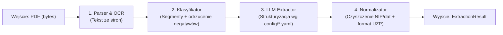

# Moduł Core (Silnik Pipeline'u i Modele Domenowe)

Katalog ten stanowi **serce logiki biznesowej aplikacji** (Core Engine). Jest w 100% odseparowany od warstwy HTTP (FastAPI) oraz interfejsu użytkownika, co pozwala na uruchamianie pipeline'u zarówno w aplikacji webowej, jak i w skryptach wsadowych czy testach automatycznych.

---

## Struktura katalogu

```text
backend/core/
├── README.md               # Niniejsza dokumentacja
├── __init__.py             # Re-eksport kluczowych interfejsów i modeli
├── models.py               # Wewnętrzne modele domenowe i DTO przepływu danych
├── pipeline.py             # Główny orkiestrator (koordynator 4 kroków przetwarzania)
└── interfaces.py           # Abstrakcje / protokoły dla wymiennych serwisów
```

---

## 1. `models.py` (Wewnętrzne DTO i stan przetwarzania)
Zawiera struktury danych używane do komunikacji pomiędzy poszczególnymi krokami pipeline'u w pamięci:
* **`DocumentType`**: Klasyfikacja dokumentów (`ODWOLANIE`, `PELNOMOCNICTWO`, `PRZELEW`, `INNY`).
* **`DocumentSegment`**: Posegmentowany fragment tekstu przypisany do wykrytej klasy wraz z metadanymi (np. zakres stron, pewność).
* **`ExtractionResult`**: Obiekt wynikowy procesu (nazwa pliku, lista odnalezionych dokumentów, kanoniczne dane UZP).

> **Różnica względem `schemas/uzp.py`:**  
> `schemas/uzp.py` definiuje **zewnętrzny, referencyjny format JSON UZP** (oceniany przez komisję).  
> `core/models.py` definiuje **wewnętrzne struktury pomocnicze** pipeline'u.

---

## 2. `pipeline.py` (Orkiestrator / Dyrygent procesu)
Implementacja fasady spinającej 4 etapy przetwarzania sprawy odwoławczej:



Główna klasa `DocumentProcessingPipeline`:
1. Przyjmuje surowe bajty pliku PDF.
2. Zleca wyciągnięcie tekstu do `services/parser`.
3. Przekazuje tekst do `services/classifier`, który dzieli go na segmenty i odrzuca dokumenty spoza zakresu.
4. Dla każdego segmentu pobiera konfigurację z `backend/config/documents/` i zleca ekstrakcję do `services/extractor`.
5. Przekazuje dane do `services/normalizer` w celu walidacji (NIP, PESEL, KRS, daty ISO) i budowy czystego JSON-a UZP.

---

## 3. `interfaces.py` (Elastyczność technologiczna – Guardrail)
Zgodnie z wymaganiem z `AGENTS.md` dotyczącym elastyczności technologicznej, pipeline nie może być na sztywno związany z konkretną biblioteką PDF ani konkretnym dostawcą LLM:
* `BasePDFParser`: Kontrakt dla parserów PDF (np. PyMuPDF, pdfplumber, fallback OCR).
* `BaseClassifier`: Kontrakt dla klasyfikatora i segmentatora dokumentów.
* `BaseLLMExtractor`: Kontrakt dla klienta LLM (np. Mistral API, vLLM, Scaleway).
* `BaseNormalizer`: Kontrakt dla modułu czyszczenia i walidacji danych.
